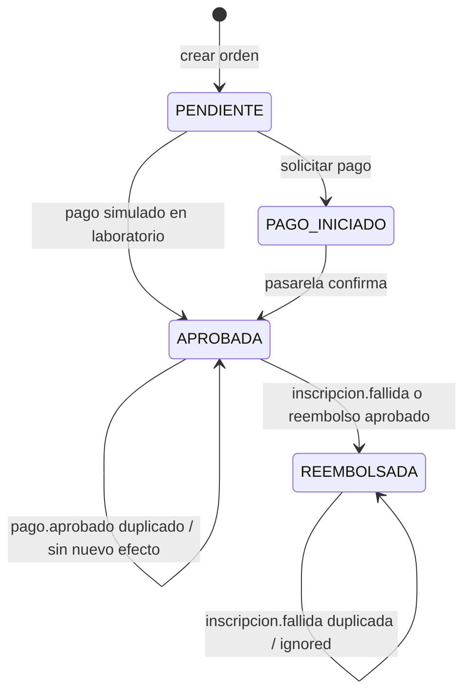

# S09 — Implementación y validación de Saga en KIDO

**Alcance S09:** backend de KIDO; el frontend existente se conserva sin modificaciones. El caso propio de negocio es **compra de curso → inscripción**, no el ejemplo Pagatu. La prueba se realiza con un Keycloak local, pagos simulados y Kafka; no efectuar las pruebas sobre dinero real.

## Arquitectura operativa

1. Pago guarda en la orden un **snapshot del curso y sus reglas académicas al crearla**, de modo que no necesite consultar Curso cuando confirma un cobro externo; después guarda la orden `APROBADA` y publica `pago.aprobado` en `kido-pago-eventos` (clave: `ordenId`, `schemaVersion=2`). El consumidor nuevo de S09 **ignora eventos históricos S08 sin esa versión**, para no compensar ventas anteriores al migrar Kafka.
2. Inscripción procesa el pago desde un consumer group propio, consulta explícitamente si la compra ya existe y persiste una inscripción. PostgreSQL respalda el control con `UNIQUE(estudiante_id, curso_id)` y `UNIQUE(orden_compra_id)`.
3. Inscripción publica `inscripcion.activada` (si se creó o ya existía) en `kido-academico-eventos`.
4. Pago consume ese evento y marca `inscripcionSincronizada=true` si la identidad del alumno/curso coincide y la orden sigue `APROBADA`.
5. Si existe un **rechazo permanente del negocio**, Inscripción publica `inscripcion.fallida` y Pago compensa la venta, revierte el movimiento del docente y, cuando se trata de una compra real, solicita el reembolso al proveedor usando clave de idempotencia.
6. Una repetición del evento produce `ignored`; la misma compensación no se aplica dos veces.
7. Una **caída temporal** de base de datos o Kafka NO publica `inscripcion.fallida`: se reintenta la entrega para evitar devolver dinero por un simple corte de infraestructura.
8. Notificaciones generadas por Kafka están protegidas con clave de evento única para evitar duplicados en la bandeja.

## Estados



`RECHAZADA` está declarado en el enum, pero el código actual no asigna ese estado: no se presenta como transición implementada. La pasarela no aprobada se rechaza con una excepción o se ignora en el webhook según la ruta.

El fallo **no borra** la compra; queda el estado final `REEMBOLSADA` para auditoría. `inscripcion.activada` tardía se ignora si la venta ya fue compensada.

## Arranque para pruebas S09

1. Copiar `.env.example` a `.env` (no subir `.env` a GitHub). Usar contraseñas locales únicas. Habilitar **solo en el laboratorio**:

   ```dotenv
   KIDO_PAGOS_PERMITIR_SIMULACION=true
   KIDO_SAGA_ESTUDIANTE_FALLO_DEMO=999999
   ```

   Para cualquier servidor real, establecer ambas en `false` y `0`, respectivamente.
2. Desde la raíz del proyecto, ejecutar `docker compose up -d --build` (Docker Desktop debe estar abierto). Verificar `docker compose ps`.
3. Validar compilación y tests desde Windows: `powershell -ExecutionPolicy Bypass -File .\scripts\verificar-s09.ps1` (Maven requiere conexión para dependencias la primera vez).
4. Ejecutar `powershell -ExecutionPolicy Bypass -File .\scripts\demo-s9-saga.ps1` desde PowerShell.
5. El script **falla con mensaje claro** si no se obtuvieron los estados o logs esperados; no interpreta un mensaje impreso como éxito.
6. Comprobar Kafka UI en `http://localhost:18085` y Eureka en `http://localhost:18761`.

## Evidencia requerida por S09

| Caso | Evidencia real que se debe capturar |
|---|---|
| Duplicado normal | Mismo `ordenId`, `status=ignored`, **una sola inscripción** |
| Fallo definitivo | `inscripcion.fallida`, `status=compensated`, orden `REEMBOLSADA`, saldo revertido |
| Duplicado de compensación | `inscripcion.fallida` repetido, `status=ignored`, sin otro reembolso |
| Diagrama | Transiciones anteriores, acordes con el código |
| Autoría | Commit con autor y aporte identificables (firma criptográfica no exigida por el manual) (revisar `git log -1 --format=fuller`) |

**Importante:** la rúbrica docente también requiere una captura de la **excepción original anterior al arreglo**. La versión corregida ya no debe generar ese error; para esa evidencia hay que usar un punto de partida S08 en un entorno de prueba aislado y capturar el fallo antes de implementar el fix. No recrear fallos reales de pagos en bases que contengan datos de usuarios. Cada captura del informe debe mostrar el reloj del sistema y el perfil del estudiante sin recortarlos.

## Tabla de eventos

| Evento | Productor | Consumidor | Topic | Efecto |
|---|---|---|---|---|
| `pago.aprobado` | Pago | Inscripción y Notificación | `kido-pago-eventos` | Crear acceso y comunicar compra |
| `inscripcion.activada` | Inscripción | Pago | `kido-academico-eventos` | Confirmar sincronización |
| `inscripcion.fallida` | Inscripción | Pago | `kido-academico-eventos` | Compensar venta |
| `curso.completado` | Inscripción | Notificación | `kido-academico-eventos` | Comunicar finalización |
| `certificado.disponible` | Inscripción | Notificación | `kido-academico-eventos` | Comunicar disponibilidad |

## Limitaciones pendientes para lanzamiento público

- **No está implementado Transactional Outbox**. Aunque el productor publique después del commit, un cierre brusco entre el guardado y el envío todavía puede dejar el evento sin publicar. No se debe afirmar que esta versión tiene entrega garantizada extremo a extremo.
- La autorización por **propiedad** del recurso debe vincular IDs de estudiante/docente al `sub`/identidad del token JWT. Hoy varias APIs admiten IDs enviados por el cliente; no exponer a usuarios desconocidos ni ejecutar pagos reales sin corregirlo.
- Un rechazo de negocio se compensa automáticamente; un fallo transitorio se reintenta de forma indefinida y requiere monitoreo/alertas. Para explotación comercial: DLQ y conciliación operativa, trazabilidad por correlación, métricas y alertas.
- Las llamadas a Mercado Pago deben endurecerse con webhooks autenticados/validados, reconciliación de reembolsos y pruebas de fallos parciales. En el flujo Saga sí se usa una clave de idempotencia del reembolso.
- El realm de Keycloak importado contiene cuentas **demostrativas** y contraseñas conocidas. Reemplazar usuarios/credenciales, HTTPS, secretos, respaldos, hosting, auditoría, políticas de archivo y pruebas de seguridad antes de internet.
- No se incorporan pagos de certificados a la Saga de compra; siguen como flujo propio. Se corrigió la aprobación simulada repetida para evitar nuevos movimientos en ese caso.

## Comandos Git seguros (no ejecutados automáticamente)

Antes de `commit` y `push`: `git config user.name` y `git config user.email`; configurar **en el clon local** la cuenta autorizada que realizó el aporte. No copiar `.git` desde otro equipo. Revisar `git status` y `git diff --cached --stat`. El ZIP no incluye historial Git ni credenciales privadas.

## Actualización de revisión S09

Ver `s09-guia-capturas.md`, `s09-matriz-rubrica.md` y `s09-informe-base.md`. El consumidor de Pago filtra los tipos de evento antes de exigir ordenId; los eventos académicos que no pertenecen a la Saga no se consideran mensajes inválidos. Pruebas locales pendientes: Maven, PostgreSQL y Docker.
