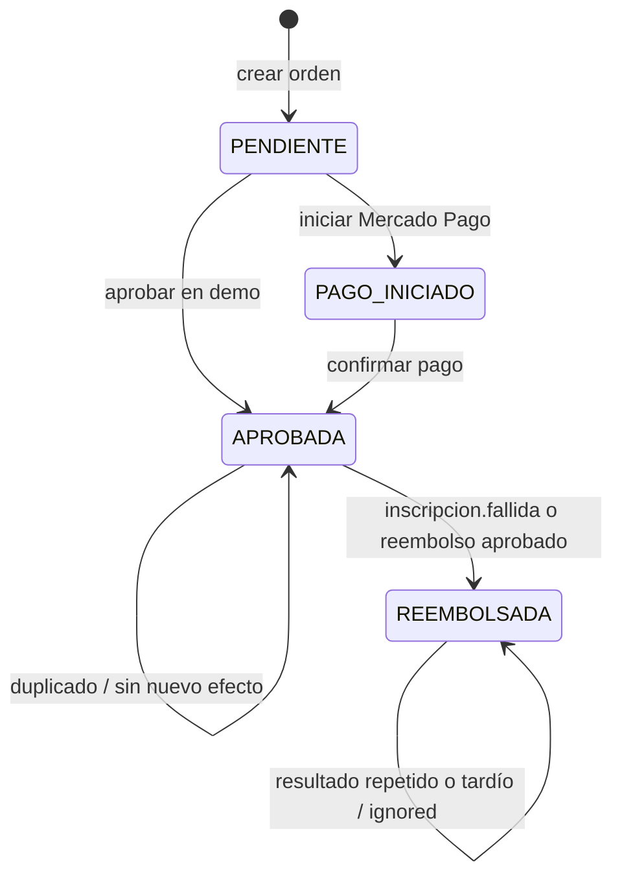

# S09 — Consistencia distribuida en procesos de negocio

**BORRADOR PARA COMPLETAR CON EVIDENCIA REAL. No subir como informe terminado.**

- Nombre: Adan Yana Rojas.
- Equipo: [número por confirmar].
- Proyecto: KIDO, plataforma de cursos.
- Sesión: S09.
- Docente: Sullon Macalupu Abel Ángel.
- Rol/aporte realizado: [describir el trabajo propio, distinguiendo el código previo del equipo y la actualización validada].
- GitHub: [URL real del repositorio/commit].
- Nombre final: S09_Equipo##_YanaAdan.pdf (ajustar según la convención exacta indicada por el docente).

## 1. Bug reproducido e idempotencia de PAGATU

[Captura real del consumidor antes del arreglo: excepción por evento orden.creada repetido. Pendiente: no se recibió el proyecto PAGATU.]

La revisión explícita evita ejecutar de nuevo una operación ya completada. La restricción UNIQUE de la base de datos respalda esa revisión cuando dos ejecuciones llegan simultáneamente. La captura posterior debe mostrar el mismo ordenId con status=ignored sin una nueva excepción ni otro pago.

[Captura posterior al fix y explicación de los identificadores reales.]

## 2. Fallo de pago y compensación en PAGATU

[Capturas pendientes de pago.fallido publicado/consumido y GET de orden CANCELADA.]

En este caso la orden se conserva para auditoría. La compensación transforma el estado de negocio después de un rechazo; no borra la operación ni revierte directamente la transacción de otra base de datos.

## 3. Compensación idempotente en PAGATU

[Captura pendiente del mismo pago.fallido reenviado y log ignored; demostrar que no se repite el efecto.]

## 4. Proceso propio: compra de curso e inscripción en KIDO

### Flujo y contrato

Pago registra la compra y, al aprobarla, publica pago.aprobado con schemaVersion=2 y key ordenId en kido-pago-eventos. Inscripción crea el acceso una sola vez y responde por kido-academico-eventos con inscripcion.activada o inscripcion.fallida. Pago confirma la sincronización o compensa la venta.

### Idempotencia

InscripcionService.crearPorCompraIdempotente consulta la inscripción del alumno/curso y reconoce el ordenCompraId ya aplicado. PostgreSQL impone uk_estudiante_curso y uk_inscripciones_orden_compra. Si ocurre un conflicto UNIQUE, el consumidor comprueba si corresponde a esa misma orden antes de reconocerlo como duplicado; no descarta cualquier error de integridad.

[Capturas 01–03: definición real de índices, orden normal y evento repetido ignorado. Insertar IDs y conteos reales.]

### Fallo y compensación

El laboratorio habilita explícitamente KIDO_SAGA_ESTUDIANTE_FALLO_DEMO=999999. Para ese estudiante, Inscripción emite inscripcion.fallida. Pago solo compensa una orden APROBADA cuya inscripción no está sincronizada: queda REEMBOLSADA y su movimiento VENTA cambia a REVERTIDO, por lo que deja de sumar al saldo del docente. En las pruebas se usan compras SIM; no se solicita un reembolso a la pasarela externa.

[Captura 04: evento publicado/consumido, orden final y movimiento real revertido.]

### Compensación repetida

Una orden ya REEMBOLSADA no cumple la guardia para compensar. El mismo resultado de fallo puede volver a llegar sin crear otra reversión. Una confirmación tardía tampoco reabre una orden compensada.

[Capturas 05–08: reenvío del JSON exacto, nuevos offsets, ignored reciente y mismo movimiento en PostgreSQL.]

### Estados implementados de la orden

RECHAZADA existe en el enum, pero no se encontró una asignación de ese estado en la implementación actual. No se dibuja una transición que el código no realiza. PAGO_INICIADO también puede aprobarse por simulación de laboratorio. La Saga empieza al aprobar el pago y termina al sincronizar la inscripción o compensar la compra.

El movimiento de venta sigue PENDIENTE → REVERTIDO en el caso de fallo; una compra correcta conserva PENDIENTE y puede liberarse a DISPONIBLE al vencer la retención según el proceso existente.

## 5. Error o hallazgo técnico

Durante la revisión del código se identificó que AcademicoResultadoConsumer validaba origen y ordenId antes de comprobar tipoEvento. El topic académico también contiene curso.completado y certificado.disponible, que no necesitan ordenId. Esos mensajes podían producir una excepción ajena al negocio de la Saga. Se agregó un filtro inicial que limita el consumidor a inscripcion.activada e inscripcion.fallida, manteniendo la validación de identidad de esos resultados.

**Estado de verificación:** hallazgo por inspección estática. [Añadir resultado real de Maven y, si se realiza, evidencia de integración; no afirmar que se observó el error en producción si no ocurrió.]

## 6. Reflexión técnica breve (7 líneas para revisar)

En un sistema distribuido, procesar un evento y confirmar su recepción son acciones separadas.
Si el consumidor guarda el resultado y se reinicia antes de confirmar el offset, Kafka puede entregarlo otra vez.
Coordinar una única ejecución entre Kafka, la base de datos y una pasarela externa requiere mecanismos adicionales.
Por eso se acepta la reentrega y se protege el efecto de negocio con consumidores idempotentes.
En KIDO, la consulta previa, los índices UNIQUE y las guardias de estado evitan repetir inscripciones y compensaciones.
Knight Capital muestra el costo que pueden tener acciones automáticas repetidas sin controles suficientes; su incidente no fue un bug de Kafka.
La idempotencia reduce los efectos duplicados, pero no sustituye el control del despliegue ni resuelve la pérdida de un evento que nunca se publicó.

## 7. Aporte individual y validación

[Enlace al commit real, archivos del aporte, fecha y resultado de los tests. Incorporar solo trabajo realizado y verificado.]

[Tabla final con nombre de prueba, ordenId, resultado, captura y fecha.]

## Anexo — Feedback de la sesión (última página del PDF)

Estas respuestas describen la experiencia del estudiante y deben completarse personalmente:

1. Aprendizaje más importante: [respuesta].
2. Punto más confuso: [respuesta].
3. Pregunta para la próxima clase: [respuesta].
4. Comprensión: [Entendido / Más o menos / Necesito ayuda].
5. Cómo puede ayudarte el docente: [respuesta].
6. Participación: [Muy comprometido / Comprometido / Poco comprometido].
7. Satisfacción con la clase: [1–10].
